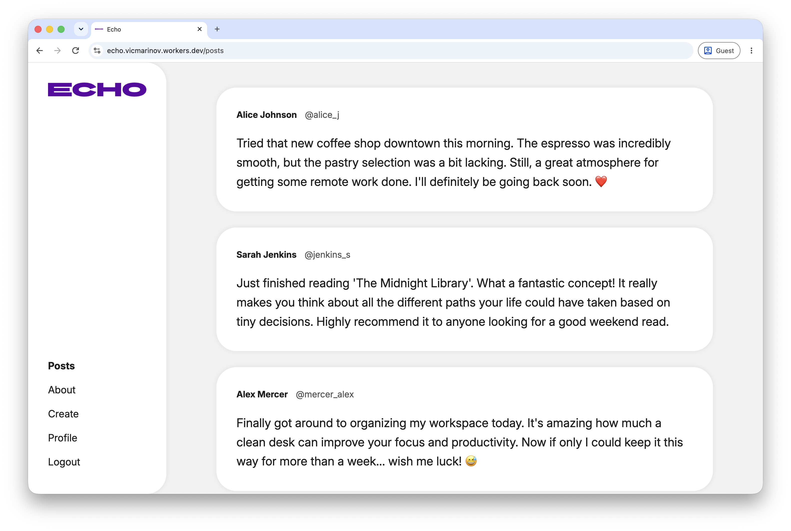
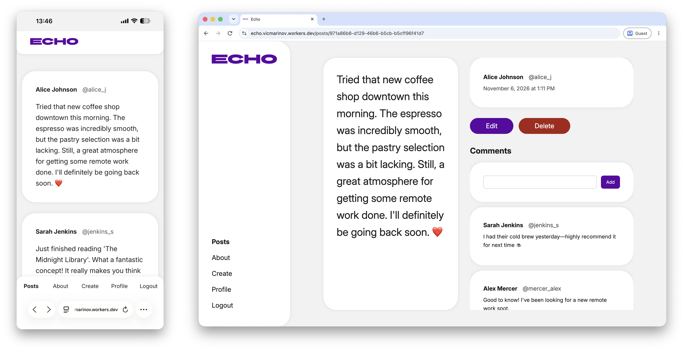

# 💬 Echo

Echo is a minimalist **microblogging social platform** for sharing posts and engaging in community discussions in a clean, distraction-free environment. The app is an **educational project** developed as part of the [**React.js** course](https://softuni.bg/trainings/5151/reactjs-september-2026) at **[SoftUni](https://softuni.bg)**.

A fully functional, **deployed version** of the app is available at **[echo.vicmarinov.workers.dev](https://echo.vicmarinov.workers.dev)**.



## 📖 Overview

- **Posts:** Browse a public feed of posts. Signed-in users can create posts and edit or delete **only their own**.
- **Comments:** Signed-in users can join the discussion on any post.
- **Profiles:** Every user has a profile page that lists their published posts.
- **Authentication:** Sign up and log in with Supabase Auth. Guests have read-only access.

A deeper description of the application's user access, authentication, routing, data operations, forms and validation, and the React techniques used is provided in the **[Functional Guide](./docs/functional-guide.md)**.



## 🛠️ Technologies & Tools Used

-  TypeScript (language)
-  React (UI library)
-  React Router (routing)
-  Supabase (database and authentication)
-  Zod Mini (form validation)
-  CSS Modules (styling)
-  Figma (UX/UI design and prototyping)
-  Vite (build tool)
-  ESLint (linting)
-  Cloudflare Workers (hosting)

## 🚀 How to Run

1. **Clone the repository** and navigate into the project directory:
    ```bash
    git clone https://github.com/vicmarinov/echo.git
    cd echo
    ```

2. **Install the dependencies** (requires [Node.js](https://nodejs.org)):
    ```bash
    npm install
    ```

3. **Configure the environment variables** in the [`.env`](./.env) file, using the credentials of your own [Supabase](https://supabase.com) project having the same database schema and authentication setup as the one in the deployed version. The [`.env`](./.env) file should look like this:
    ```env
    SUPABASE_PROJECT_ID="your-project-id"
    VITE_SUPABASE_URL="https://your-project-id.supabase.co"
    VITE_SUPABASE_KEY="your-publishable-key"
    ```

4. **Start the development server** with `npm run dev`.

    Use `npm run build` to create a production build, `npm run lint` to lint the code, and `npm run deploy` to deploy the app to Cloudflare Workers.